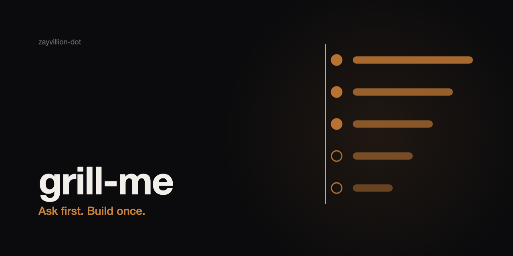

# Grill Me



A Claude Code skill that makes the agent interrogate you before it starts a significant, vague task. Wrong assumptions on a new build, offer, page, or client are expensive, and one long questionnaire answered once does not fix that. This skill runs a loop: read the workspace first, ask 3-5 questions per round (each with a suggested default), pin vague answers to something observable, play back a brief, and begin work only after you confirm it.

**Use it when** you say "grill me", "interrogate me", or "ask me questions first", invoke `/grill-me`, or hand over a big vague task: new build, new offer, new page, new client, big change.

**Not when** the task is small and well specified (a typo, one copy tweak, work with an already confirmed spec). There the agent should confirm the one ambiguous point and proceed.

## Install

**As a plugin:**

```
/plugin marketplace add zayvillion-dot/grill-me
/plugin install grill-me@grill-me
```

**Manual:**

Copy `skills/grill-me/` into `~/.claude/skills/`.

## Example

> **You:** Grill me. I want a landing page for our new service.
>
> **Claude** (after reading the repo):
> 1. Who lands here and from where? (default: first-time visitor from search)
> 2. What is the one action to drive? (default: a single call to action)
> 3. Replace the current services page or stand alone? (default: stand alone)
>
> **You:** 1 default, 2 default, 3 replace it.
>
> Claude follows up on anything vague, runs a second round, plays back a brief, and asks "anything wrong or missing?" before touching a file.

## What is inside

- `skills/grill-me/SKILL.md`: the method (recon, rounds, brief, gate).
- `skills/grill-me/references/question-bank.md`: seed questions by task type, each with a default.
- `skills/grill-me/references/answers-template.md`: record block for answers and defaults in force.

## Known gaps in 0.1.0

1. No clean RED baseline yet. The only baseline run was contaminated by project rules; see `docs/red-baseline-prompt.md` for the clean-run prompt.
2. The question bank is seed-level: a starting set, not tuned against real sessions.

## License

MIT, see `LICENSE`.
